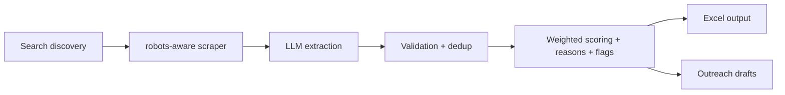

# Coffee Buyer Lead-Generation Pipeline

An automated pipeline that discovers, scrapes, classifies and scores international buyers of specialty coffee, then drafts personalised outreach for the best leads. Built around a coffee-export use case: finding roasters, importers and traders who could buy Indian coffee.

> Outreach is **drafted only, never sent**. No real company is contacted by this project.

## What it does

1. **Discover** candidate companies per market with web search queries
2. **Scrape** each company's public pages (about, contact, team), respecting `robots.txt`
3. **Extract** structured data with an LLM, constrained to the page text (`null` when unknown)
4. **Validate and deduplicate** by domain, normalised company name and email
5. **Score** each lead with a transparent weighted framework, with a written reason and data flags
6. **Export** a prioritised Excel database
7. **Draft** personalised outreach for the top leads from stored facts only



## Results

| Market | Leads | Target |
|---|---|---|
| USA & Canada | [x] | 25 |
| Europe | [x] | 30 |
| Japan & South Korea | [x] | 15 |
| UAE & GCC | [x] | 15 |
| Australia & Singapore | [x] | 15 |
| **Total** | **[x]** | **100** |

- Websites scraped: [x] | skipped because of `robots.txt`: [x] | unreachable: [x]
- Known gap: [e.g. Japan/Korea is below target because many sites disallow automated access and free search returned few usable results. The limits were respected, not bypassed.]

Masked sample output: [`sample_data/sample_leads.csv`](sample_data/sample_leads.csv)

## Scoring framework

| Parameter | Weight | How it is computed |
|---|---|---|
| Relevance to specialty coffee | 30% | Keyword signals in site text plus buyer type |
| Potential to source Indian coffee | 25% | India mentioned, buys green coffee, multi-origin sourcing |
| Business and buyer fit | 20% | Importer, trader and roaster rank highest |
| Market suitability | 15% | Fixed score per market (an assumption, not data) |
| Contact information | 10% | Public email, named decision-maker, LinkedIn, phone |

Scoring is rule-based on the extracted fields, so scores are reproducible and every one comes with a reason. Tiers: **A** (70+), **B** (50-69), **C** (under 50).

## Verified facts vs AI assumptions

- Columns marked **(V)** come straight from the company's public website, with a source URL
- Columns marked **(AI)** were extracted or inferred by an LLM and need checking
- The model is told to return `null` rather than guess. Missing fields show "Not found" and appear in the `Data flags` column
- A country filter removes Indian exporters, which an LLM can mislabel as importers

## Responsible scraping

- Checks `robots.txt` before every page and skips sites that disallow access
- Sends an identifying User-Agent, uses delays, limits pages per site
- No login bypass, CAPTCHA bypass or access-control circumvention
- Collects only public business information, nothing sensitive
- If you use this for real outreach, follow the law in the recipient's country (GDPR, CAN-SPAM and similar) and verify contacts first

## Setup

```bash
git clone https://github.com/<your-username>/coffee-buyer-lead-gen-pipeline.git
cd coffee-buyer-lead-gen-pipeline
python -m venv venv
venv\Scripts\activate            # macOS/Linux: source venv/bin/activate
pip install -r requirements.txt
copy .env.example .env           # macOS/Linux: cp .env.example .env
# edit .env and add your API key
```

## Usage

```bash
python run_pipeline.py              # scrape -> extract -> score -> outreach
python run_pipeline.py --discover   # also run fresh company discovery
```

Stages can also run one at a time: `discover*.py`, `scrape.py`, `extract.py`, `score.py`, `outreach.py`.

Every stage is **resumable**. It skips domains already processed, so re-running is safe and cheap.

Outputs (created locally, git-ignored): `candidates.csv`, `scraped.csv`, `extracted.csv`, `OrchardGate_Buyers.xlsx` (Prospects, Top 20, Legend), `outreach_drafts.xlsx`, `pipeline_log.txt`.

### Optional API

```bash
uvicorn api:app --port 8000
```
Docs at http://localhost:8000/docs. Endpoints: `/api/pipeline/run`, `/status`, `/logs`, `/api/leads`, `/api/outreach`, `/api/stats`, `/api/export.csv`. A frontend [built with Emergent] can call these.

## Project files

| File | Purpose |
|---|---|
| `discover.py`, `discover_jp.py`, `discover_topup.py` | Candidate discovery by market |
| `scrape.py` | Robots-aware scraper: emails, LinkedIn links, phones, page text |
| `extract.py` | LLM extraction and classification with provider fallback |
| `score.py` | Dedup, scoring, flags, quotas, Excel export |
| `outreach.py` | Outreach drafts for the top leads |
| `run_pipeline.py` | Runs the whole workflow with a log |
| `api.py` | FastAPI wrapper for a frontend |
| `make_sample.py` | Creates the masked sample data |

## Automated vs manual

- **Automated:** discovery, scraping, extraction, classification, dedup, scoring, flagging, draft generation
- **Manual:** reviewing the top leads against their websites, choosing outreach targets, editing drafts, [any manual seeding]

## Challenges and what I learned

- **Bot blocking:** [x] sites disallowed automated access in `robots.txt`. I respected that and documented the effect on coverage
- **Unreliable free LLM tiers:** free models were rate-limited, overloaded or retired mid-run, so I built a provider fallback (OpenAI, Gemini, OpenRouter) and made every stage resumable
- **Hallucination control:** the prompt forces `null` for unknown fields, scoring is rule-based, and the output separates verified (V) from AI (AI) columns
- **Misclassification:** the model labelled an Indian exporter as an importer, which led to a country filter and a manual review step
- **Contact mismatches:** the first scraped email did not always match the named decision-maker, so a matching function now prefers the email that fits the name

## Limitations

- Free search is limited and can be rate-limited from cloud IPs
- Names and emails are captured only when publicly listed
- Market scores are an assumption, not measured data
- The AI can still be wrong, so keep the review step

## Next steps

Paid search API for discovery, email verification, CRM sync (Google Sheets or Airtable), scheduled runs, and a review queue for low-confidence leads. At 1,000 leads a month: queue-based workers, a database instead of CSVs, caching, and per-domain rate limits.

## AI tools used

- Claude (Anthropic): coding help and debugging
- OpenAI [model]: extraction and outreach drafting inside the pipeline
- [Gemini / OpenRouter as fallbacks, if used]
- [Emergent: frontend UI, if used]

I built, ran and tested the pipeline myself. [Describe what you wrote, adapted and debugged, and which parts were AI-generated.]

## License

MIT
